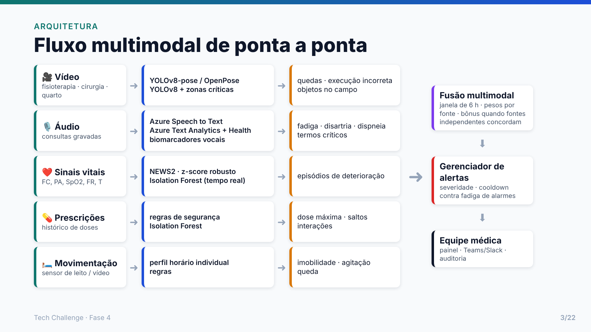

# Tech Challenge Fase 4 — Monitoramento Multimodal de Pacientes

Projeto desenvolvido para o **Tech Challenge da Fase 4** da pós-graduação em IA para Devs.

O hospital, que já utiliza modelos para analisar exames e documentos, agora quer **monitorar continuamente os pacientes** combinando **vídeo, áudio e texto/sinais** para identificar sinais precoces de risco. Este repositório implementa esse fluxo de ponta a ponta:

- **Vídeo**: YOLOv8-pose e OpenPose para análise postural (sessões de fisioterapia, quedas) e YOLOv8 para objetos e áreas críticas (cirurgias), com relatório automático dos desvios;
- **Áudio**: Azure Speech to Text para transcrever consultas, Azure Text Analytics (incluindo *Text Analytics for Health*) para sentimento e termos críticos, e biomarcadores vocais de fadiga, disartria e dificuldade respiratória;
- **Detecção de anomalias**: sinais vitais (NEWS2 + z-score robusto + Isolation Forest por paciente, inclusive em tempo real), evolução das prescrições e padrões de movimentação durante a internação;
- **Alertas**: fusão multimodal do risco, controle de fadiga de alarmes e envio para a equipe médica (console, trilha de auditoria, webhook do Teams/Slack e painel HTML).

> **Importante:** projeto exclusivamente acadêmico. Os dados são sintéticos ou públicos e o sistema não deve ser usado para diagnóstico ou decisão clínica.

📄 **Relatório técnico:** [`docs/relatorio_tecnico.md`](docs/relatorio_tecnico.md)
☁️ **Configuração do Azure:** [`docs/azure_setup.md`](docs/azure_setup.md)
📊 **Painel de exemplo:** [`outputs/painel_equipe_medica.html`](outputs/painel_equipe_medica.html) (baixe e abra no navegador)
🎬 **Vídeo de apresentação:** _link do YouTube_



## Estrutura do projeto

```
├── config/settings.yaml        # limiares, modelos, zonas críticas, pesos da fusão
├── src/hospital_monitor/
│   ├── video/                  # pose (YOLOv8-pose/OpenPose), biomecânica e analisador de vídeo
│   ├── audio/                  # biomarcadores vocais, termos críticos e analisador de áudio
│   ├── azure/                  # Azure Speech to Text e Azure Text Analytics
│   ├── anomaly/                # sinais vitais, prescrições e movimentação
│   ├── data/                   # geração de dados sintéticos e leitores do PhysioNet
│   ├── alerts.py               # alertas, canais e gerenciador
│   ├── fusion.py               # fusão multimodal de risco
│   ├── report.py               # gráficos e painel da equipe médica
│   └── pipeline.py             # fluxo completo
├── scripts/
│   ├── run_demo.py             # executa tudo e gera o painel
│   ├── run_video.py            # analisa um vídeo
│   ├── run_audio.py            # analisa o áudio de uma consulta
│   ├── simulate_realtime.py    # monitoramento de sinais vitais em tempo real
│   └── simulate_videos.py      # gera os vídeos de demonstração
├── notebooks/tech_challenge_fase4.ipynb   # demonstração passo a passo (Colab)
├── data/samples/               # dados de demonstração (CSV, áudios, vídeos)
├── outputs/                    # resultados gerados (relatórios, figuras, alertas, painel)
├── docs/                       # relatório técnico e guias
└── tests/                      # testes automatizados
```

## Como executar

Requer Python 3.10 ou superior.

```bash
git clone https://github.com/julianajjo/pos-tech-challenge-fase-4.git
cd pos-tech-challenge-fase-4
python -m venv .venv && source .venv/bin/activate      # Windows: .venv\Scripts\activate
pip install -r requirements.txt
```

Opcionalmente, configure o Azure (veja [`docs/azure_setup.md`](docs/azure_setup.md)):

```bash
cp .env.example .env    # preencha as chaves
```

Sem as chaves, o sistema usa alternativas locais e continua funcionando.

### Fluxo completo

```bash
python scripts/run_demo.py
```

Processa os sinais vitais, prescrições, movimentação, os áudios das consultas e os vídeos; executa a fusão; mostra os alertas no console e gera em `outputs/`:

- `painel_equipe_medica.html` — painel com risco por paciente, alertas e evidências;
- `alerts/alerts.json` — todos os alertas emitidos;
- `resumo_resultados.json` — métricas (episódios detectados, comparação com NEWS2, indicadores vocais...);
- `figuras/`, `audio/` e `video/<nome>/` — gráficos, relatórios automáticos, imagens dos eventos e vídeos anotados.

### Módulos individuais

```bash
# vídeo (modos: fisioterapia | cirurgia | monitoramento)
python scripts/run_video.py data/samples/queda_simulada.mp4 --paciente P004 --modo monitoramento
python scripts/run_video.py minha_sessao.mp4 --paciente P010 --modo fisioterapia

# áudio de consulta (wav, mp3, m4a...)
python scripts/run_audio.py data/samples/consulta_P001.wav --paciente P001

# monitoramento de sinais vitais em tempo real (replay acelerado)
python scripts/simulate_realtime.py --paciente P002 --inicio "2026-11-10 19:30" --minutos 60

# testes
python -m pytest
```

### Google Colab

Abra `notebooks/tech_challenge_fase4.ipynb` no Colab. A primeira célula clona o repositório e instala as dependências.

### OpenPose

O padrão é o **YOLOv8-pose**, que roda bem em CPU. Para usar o **OpenPose**:

- **binário oficial** (recomendado, multi-pessoa): rode o OpenPose com `--write_json saida/` e importe os keypoints:
  `python scripts/run_video.py video.mp4 --modo fisioterapia --openpose-json saida/`
- **OpenCV DNN**: coloque `pose_deploy_linevec.prototxt` e `pose_iter_440000.caffemodel` (modelo COCO do repositório do OpenPose) em `models/openpose/` e use `--backend openpose`.

### Dados reais do PhysioNet

`src/hospital_monitor/data/physionet.py` lê os arquivos `bidmc_XX_Numerics.csv` do [BIDMC PPG and Respiration Dataset](https://physionet.org/content/bidmc/1.0.0/) e registros numéricos do MIMIC (via `wfdb`), convertendo para o formato usado pelos detectores.

## Principais resultados

| Modalidade | Resultado |
|---|---|
| Sinais vitais | 3 de 3 episódios clínicos detectados, sem falsos positivos; deterioração de P001 detectada 56 min antes do NEWS2 isolado; crise hipertensiva que o NEWS2 não detectaria foi encontrada pelo Isolation Forest |
| Prescrições | dose de morfina 2x acima do máximo, interação varfarina + AAS, dupla anticoagulação e instabilidade na prescrição de insulina |
| Movimentação | imobilidade prolongada, agitação noturna em duas madrugadas e assinatura de queda |
| Áudio | escore de dificuldade respiratória 0,85 e de fadiga 0,64 na consulta alterada contra 0,20 e 0,31 na consulta normal; 7 termos clínicos críticos identificados |
| Vídeo | 8 repetições de agachamento contadas, 4 fora do padrão (amplitude, tronco, assimetria); queda detectada em 4,6 s |
| Fusão | 26 alertas, 3 de risco multimodal confirmados por fontes independentes |

Detalhes, gráficos e discussão no [relatório técnico](docs/relatorio_tecnico.md).
