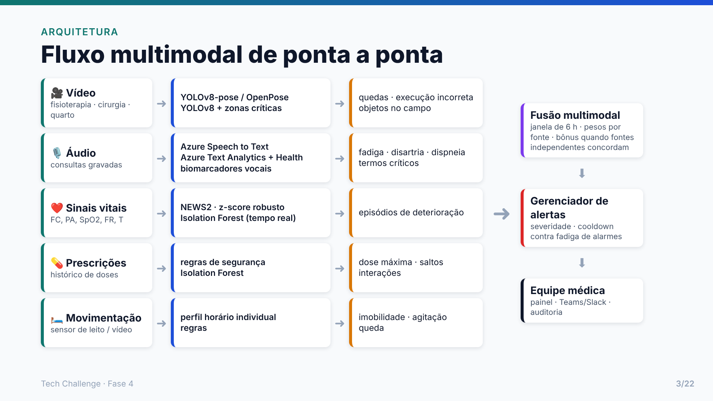
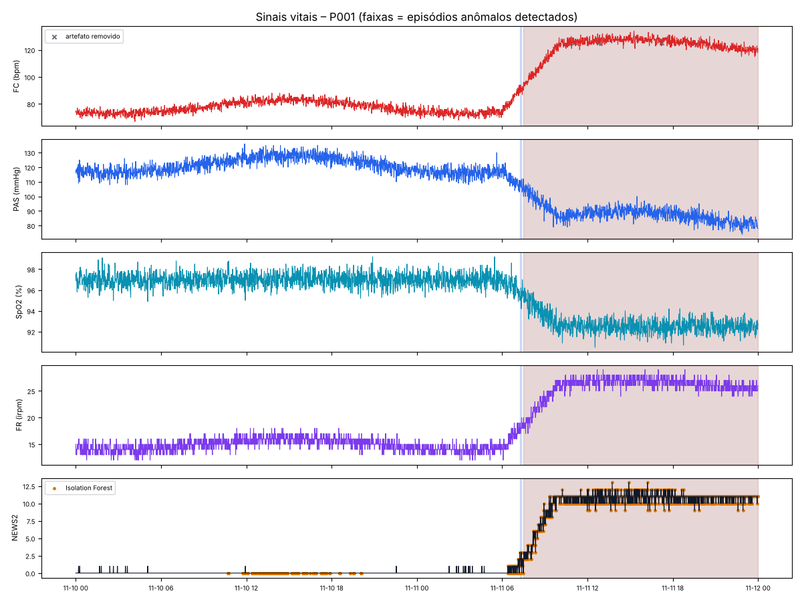
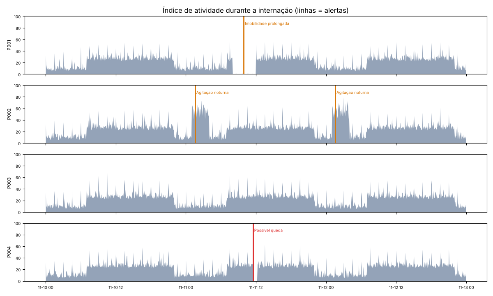
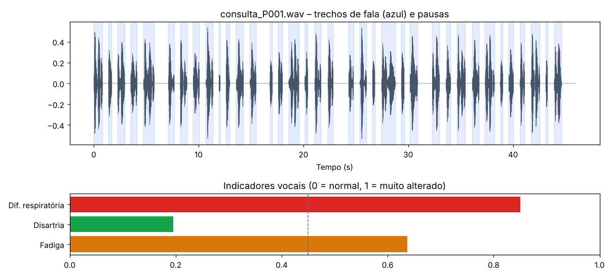
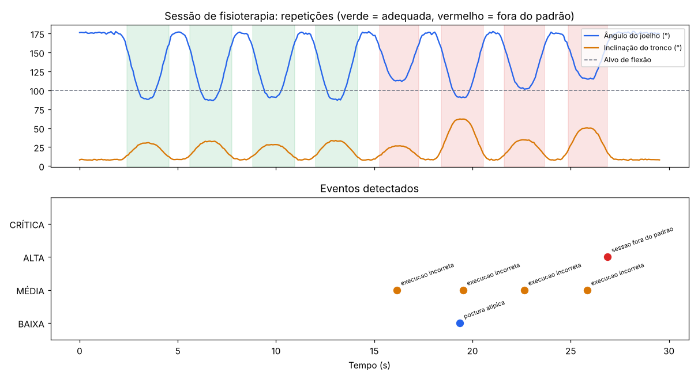
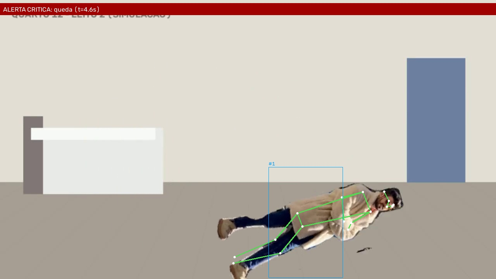
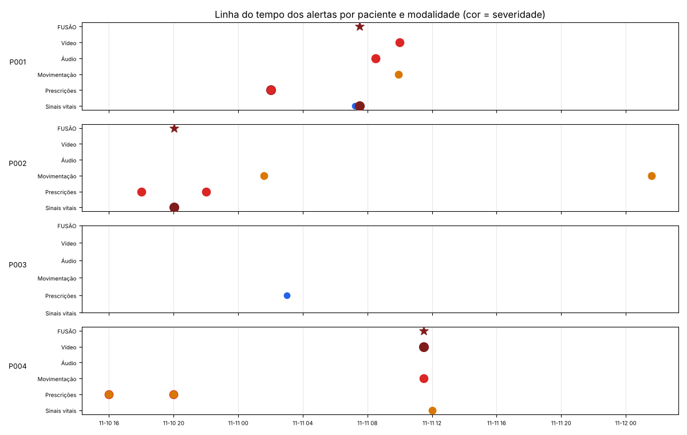

# Relatório Técnico – Tech Challenge Fase 4

**Monitoramento multimodal de pacientes com detecção de anomalias em tempo real**

> Projeto acadêmico. Os dados utilizados são sintéticos ou públicos e o sistema não deve ser usado para diagnóstico ou decisão clínica real.

## 1. Contexto e objetivo

Na fase anterior, o hospital passou a usar modelos para apoiar a análise de exames, laudos e documentos. Nesta fase o objetivo é **monitorar continuamente os pacientes** a partir de dados de naturezas diferentes e **avisar a equipe o quanto antes** quando algo foge do esperado.

O sistema desenvolvido:

- analisa **vídeos** de sessões de fisioterapia, de cirurgias e do quarto/corredor;
- analisa **áudios de consultas**, transcrevendo com o **Azure Speech to Text** e interpretando o texto com o **Azure Text Analytics** (incluindo o *Text Analytics for Health*), além de medir biomarcadores vocais de fadiga, disartria e dificuldade respiratória;
- detecta **anomalias** em séries temporais de **sinais vitais**, na **evolução das prescrições** e nos **padrões de movimentação** durante a internação;
- **funde** os achados das diferentes fontes em um risco único por paciente e **gera alertas** para a equipe médica (console, trilha de auditoria, webhook do Teams/Slack e painel HTML).

## 2. Fluxo multimodal



O fluxo segue uma arquitetura de **fusão tardia** (*late fusion*): cada modalidade é processada por um módulo especializado, que produz **eventos padronizados** (`Alert`) com origem, severidade, escore de 0 a 1, evidências e conduta sugerida. Isso permite evoluir cada módulo de forma independente e acrescentar novas fontes sem alterar as demais.

| Etapa | Entrada | Processamento | Saída |
|---|---|---|---|
| 1. Ingestão | vídeo (mp4/avi), áudio (wav/m4a/mp3), CSV de sinais vitais (1 amostra/min), prescrições e índice de atividade | leitura, reamostragem e limpeza | dados padronizados |
| 2. Vídeo | frames | YOLOv8-pose / OpenPose → keypoints; YOLOv8 → objetos; biomecânica e regras | eventos de vídeo + relatório automático + vídeo anotado |
| 3. Áudio | áudio da consulta | Azure Speech → transcrição; librosa → biomarcadores; Azure Text Analytics → sentimento, entidades clínicas e negações | indicadores vocais + termos críticos |
| 4. Anomalias | séries temporais e eventos clínicos | NEWS2, z-score robusto, Isolation Forest, regras de segurança do paciente | episódios anômalos |
| 5. Fusão | todos os alertas do paciente | janela deslizante de 6 h, ponderação por modalidade e bônus de corroboração | alerta de risco multimodal |
| 6. Resposta | alertas | *cooldown* contra fadiga de alarmes, roteamento por severidade | console, `alerts.jsonl`, webhook, painel da equipe |

O código está organizado no pacote `src/hospital_monitor`:

```
hospital_monitor/
├── video/      pose.py (YOLOv8-pose, OpenPose), kinematics.py, analyzer.py
├── audio/      features.py (biomarcadores), local_text.py (termos críticos), analyzer.py
├── azure/      speech.py (Speech to Text), language.py (Text Analytics + Health)
├── anomaly/    vitals.py, prescriptions.py, movement.py
├── data/       synthetic.py (dados de demonstração), physionet.py (leitores PhysioNet)
├── alerts.py   modelo de alerta, canais e gerenciador
├── fusion.py   fusão multimodal de risco
├── report.py   gráficos e painel HTML
└── pipeline.py orquestração ponta a ponta
```

## 3. Dados

| Fonte | Origem | Observação |
|---|---|---|
| Sinais vitais | sintéticos, minuto a minuto, 48 h, 4 pacientes, nas faixas e resolução das bases *BIDMC* e *MIMIC Numerics* do **PhysioNet** | leitores prontos para os arquivos reais (`data/physionet.py`) |
| Prescrições | histórico sintético de 19 prescrições | inclui erros conhecidos (dose 10x, interação, duplicidade, ajustes frequentes) |
| Movimentação | índice de atividade a cada 5 min (sensor de leito/acelerômetro), 3 dias | também pode ser derivado do vídeo (`activity_from_video_tracks`) |
| Áudio | duas consultas em pt-BR com voz sintetizada (*espeak-ng*): uma fluente e uma com fala lenta e pausas respiratórias | qualquer gravação real pode ser analisada com `scripts/run_audio.py` |
| Vídeo | (a) sessão de agachamento gerada a partir de um modelo biomecânico, com keypoints no formato JSON do OpenPose; (b) queda simulada com pessoa real recortada por YOLOv8-seg e processada pelo YOLOv8-pose; (c) vídeo público de corredor (`vtest.avi`, OpenCV) | vídeos reais podem ser analisados com `scripts/run_video.py` |

O uso de dados sintéticos foi uma escolha deliberada: dados reais de pacientes são dados pessoais sensíveis pela LGPD, e os dados sintéticos permitem **inserir episódios clínicos conhecidos** e medir objetivamente se o sistema os detecta (verdade de referência). A sugestão do *AudioSet* não foi necessária porque o foco do áudio foi a voz em consultas, mas o pipeline aceita qualquer arquivo de áudio.

## 4. Modelos aplicados em cada tipo de dado

### 4.1 Vídeo

| Tarefa | Modelo / técnica | Detalhes |
|---|---|---|
| Pose humana | **YOLOv8n-pose** (padrão) | 17 keypoints COCO, multi-pessoa, rastreamento **ByteTrack** |
| Pose humana | **OpenPose** (CMU) | via OpenCV DNN (modelo Caffe COCO-18) ou importando a saída `--write_json` do binário oficial (COCO-18/BODY_25), convertida para o mesmo formato |
| Objetos e áreas críticas | **YOLOv8n** (COCO, 80 classes) | zonas poligonais configuráveis por tipo de vídeo (campo cirúrgico, corredor restrito) |
| Biomecânica | geometria dos keypoints | ângulos de joelho, quadril, cotovelo e ombro, inclinação do tronco, centro do quadril, razão largura/altura da pessoa |
| Execução do exercício | máquina de estados + regras do protocolo | conta repetições pelo ângulo do joelho e verifica amplitude mínima, inclinação do tronco e assimetria entre os lados |
| Postura atípica | **Isolation Forest** | sobre ângulos articulares e velocidade vertical do quadril, por pessoa |
| Queda | regra cinemática | quadril desce mais de 25% da altura corporal em menos de 1 s e a pessoa termina na horizontal; trajetórias são "costuradas" quando o rastreador troca o ID durante a queda |
| Cirurgia | regras de zona | objetos não esperados no campo, excesso de pessoas, instrumento presente no campo ao final do vídeo |

O relatório automático de cada vídeo (`outputs/video/<video>/relatorio_video.md`) traz a lista de desvios com horário, a tabela de repetições, o gráfico da linha do tempo, imagens dos eventos e o vídeo anotado com esqueleto, zonas e faixas de alerta.

### 4.2 Áudio

| Tarefa | Modelo / técnica | Detalhes |
|---|---|---|
| Transcrição | **Azure AI Speech – Speech to Text** | reconhecimento contínuo em pt-BR, saída detalhada com confiança e **tempo de cada palavra** (usado para calcular palavras por minuto) |
| Sentimento | **Azure Text Analytics** | sentimento por documento e por frase, com *opinion mining* |
| Termos e entidades | **Azure Text Analytics** | frases-chave, NER e **Text Analytics for Health** (sintomas, diagnósticos, medicamentos, com asserção de negação e códigos UMLS) |
| Termos críticos | léxico clínico com tratamento de negação | mapeia sintomas para severidade (ex.: "dor no peito" e "fala enrolada" são críticos; "nega dor no peito" não gera alerta) |
| Biomarcadores vocais | **librosa** (pYIN, RMS, planura espectral) | taxa de articulação, proporção e número de pausas, pausas por minuto, duração das frases, variação de F0 em semitons, jitter e shimmer aproximados, soprosidade e queda de energia |
| Indicadores clínicos | escores ponderados (0 a 1) | **fadiga** (fala lenta, monotonia, pausas longas, queda de energia), **disartria** (fala lenta, ritmo irregular, jitter, shimmer) e **dificuldade respiratória** (pausas respiratórias, frases curtas, pausas, soprosidade) |

Quando as chaves do Azure não estão configuradas, o sistema continua funcionando com alternativas locais (transcrição de referência ou `faster-whisper`, e análise de sentimento por léxico). Isso garante que o monitoramento não pare caso o serviço de nuvem fique indisponível.

### 4.3 Detecção de anomalias

**Sinais vitais** (FC, PAS, PAD, SpO2, FR, temperatura):

1. **Filtro de artefatos**: leituras fisiologicamente impossíveis e picos de uma única amostra (ex.: oxímetro solto) são removidos antes da análise, reduzindo alarmes falsos.
2. **NEWS2** (*National Early Warning Score 2*): escore clínico validado; NEWS2 ≥ 5 ou qualquer parâmetro com pontuação 3 caracteriza deterioração.
3. **z-score robusto** (mediana/MAD) em janela móvel de 60 min, olhando só para o passado.
4. **Isolation Forest multivariado por paciente**, treinado nas 6 primeiras horas do próprio paciente (linha de base individual), com variações de 15 min e índice de choque (FC/PAS) como atributos, e confirmação temporal de 3 em 5 minutos.

Um minuto é anômalo quando o NEWS2 indica risco ou quando o Isolation Forest concorda com o z-score ou com um NEWS2 intermediário. Minutos anômalos próximos são agrupados em **episódios**, cuja severidade segue o NEWS2 máximo. Há também um **monitor em tempo real** (`StreamingVitalsMonitor`) que processa uma amostra por vez e alerta no início de um episódio e quando a gravidade aumenta (`scripts/simulate_realtime.py`).

**Prescrições**: regras de segurança inspiradas nas recomendações do ISMP para medicamentos de alta vigilância (dose acima do máximo diário, salto de dose maior que 2x em relação à prescrição anterior, muitas alterações em 24 h, interações e duplicidade terapêutica) e **Isolation Forest** sobre as características de cada alteração para apontar padrões raros não cobertos pelas regras.

**Movimentação**: perfil horário individual (mediana/MAD por hora do dia aprendidos no primeiro dia) para detectar **agitação noturna**; regras para **imobilidade prolongada** em período diurno (risco de lesão por pressão) e **assinatura de queda** (pico de impacto seguido de inatividade).

### 4.4 Fusão e alertas

Para cada paciente, em uma janela de 6 h:

```
risco = 0,5 · max(escores) + 0,5 · média ponderada(escores) + 0,15 · (k − 1)
```

em que *k* é o número de modalidades com escore ≥ 0,4 (pesos: sinais vitais 0,35; áudio 0,20; vídeo, movimentação e prescrição 0,15). O alerta de fusão só é gerado quando há **pelo menos duas fontes concordantes**, o que dá mais confiança ao aviso e prioriza os pacientes em que diferentes evidências apontam para o mesmo problema.

O `AlertManager` aplica *cooldown* de 15 min para o mesmo paciente/origem/tipo (combate à **fadiga de alarmes**) e distribui os alertas para os canais: console, arquivo JSON Lines (trilha de auditoria), **webhook** (Microsoft Teams ou Slack, a partir da severidade ALTA) e o **painel HTML da equipe médica** (`outputs/painel_equipe_medica.html`), com risco por paciente, lista de alertas com conduta sugerida e as evidências (gráficos e imagens dos eventos).

## 5. Resultados obtidos

Os resultados abaixo são gerados por `python scripts/run_demo.py` e estão em `outputs/`.

### 5.1 Sinais vitais

| Paciente | Episódio inserido | Início real | 1ª detecção do sistema | Somente NEWS2 ≥ 5 | Métodos |
|---|---|---|---|---|---|
| P001 | deterioração compatível com sepse (rampa de 4 h) | 11/11 06:00 | **07:14** (alerta crítico às 07:30) | 08:10 | NEWS2, Isolation Forest |
| P002 | dessaturação aguda (SpO2 ~84%) | 10/11 20:00 | **20:01** | 20:02 | NEWS2, z-score, Isolation Forest |
| P004 | crise hipertensiva (PAS > 180 mmHg) | 11/11 12:00 | **12:02** | **não detectaria** | z-score, Isolation Forest |

- **3 de 3** episódios detectados (recall 100%) e **nenhum episódio falso** no paciente estável P003 ou fora dos episódios.
- **24 artefatos** de sensor removidos sem gerar alarme.
- Na deterioração lenta de P001, a combinação com o modelo estatístico sinalizou o problema **56 minutos antes** do que o NEWS2 sozinho.
- A crise hipertensiva de P004 **não seria detectada pelo NEWS2** (a PAS só pontua acima de 219 mmHg) e foi encontrada pelo z-score e pelo Isolation Forest, mostrando o valor de combinar regra clínica e modelo por paciente.



### 5.2 Prescrições e movimentação

| Paciente | Anomalia | Severidade |
|---|---|---|
| P001 | Morfina 20 mg 6x/dia = 120 mg/dia (máximo de referência 60 mg) e aumento de 10x em relação à prescrição anterior | CRÍTICA / ALTA |
| P002 | Interação Varfarina + AAS e dupla anticoagulação com Enoxaparina | ALTA |
| P004 | Insulina regular com 5 alterações em 24 h, salto de 2,5x e redução para 0,4x | ALTA / MÉDIA |
| P003 | Ajuste de frequência da Losartana apontado apenas pelo Isolation Forest para revisão farmacêutica | BAIXA |
| P001 | Imobilidade de 2 h em período diurno | MÉDIA |
| P002 | Agitação noturna em duas madrugadas (z = 6,7 e 5,5) | MÉDIA |
| P004 | Possível queda (pico de impacto seguido de 30 min de inatividade) | ALTA |

O paciente P003 (controle) não teve alertas de movimentação nem de prescrição de severidade média ou maior.



### 5.3 Áudio das consultas

| Medida | P003 (fala fluente) | P001 (fadiga/dispneia) |
|---|---|---|
| Taxa de articulação (sílabas/s) | 4,9 | 3,2 |
| Tempo em pausa | 8% | 51% |
| Pausas por minuto | 14 | 47 |
| Duração média das frases (s) | 2,4 | 0,6 |
| Pausas longas (≥ 1 s) | 0 | 4 |
| **Escore de fadiga** | 0,31 | **0,64** (MÉDIA) |
| **Escore de dificuldade respiratória** | 0,20 | **0,85** (ALTA) |
| Termos críticos | nenhum | falta de ar, fraqueza, febre, calafrios, tontura, cansaço, falta de apetite |
| Sentimento | positivo | negativo |



### 5.4 Vídeo

- **Sessão de fisioterapia (agachamento)**: 8 repetições contadas corretamente. As 4 primeiras foram adequadas; foram detectadas amplitude insuficiente (repetição 5, joelho a 113°), inclinação excessiva do tronco (repetição 6, 62°), assimetria entre joelhos (repetição 7, 34°) e compensação por fadiga (repetição 8). Como metade das repetições ficou fora do padrão, foi gerado o alerta **"sessão fora do padrão" (ALTA)**.
- **Queda simulada no quarto**: o YOLOv8-pose acompanhou a pessoa caminhando e o rastreador trocou o ID no momento da queda; após a união das trajetórias, a queda foi detectada em **t = 4,6 s** (o quadril desceu 34% da altura do corpo) com severidade **CRÍTICA**.
- **Vídeo de corredor** (`vtest.avi`, 80 s): 13 pessoas rastreadas e nenhum evento, como esperado para uma circulação normal (controle negativo). Relatório em `outputs/video/corredor_vtest/`.





### 5.5 Fusão e alertas

Foram gerados **26 alertas** (7 críticos, 9 altos, 7 médios, 3 baixos), sendo **3 alertas de fusão multimodal**:

| Paciente | Horário | Fontes concordantes | Situação |
|---|---|---|---|
| P002 | 10/11 20:01 | sinais vitais + prescrição | dessaturação em paciente com interação anticoagulante |
| P001 | 11/11 07:30 | sinais vitais + prescrição, depois reforçado por áudio, movimentação e vídeo | deterioração clínica em paciente com dose de morfina acima do máximo, voz com sinais de dispneia e sessão de fisioterapia fora do padrão |
| P004 | 11/11 11:30 | vídeo + sensor de movimentação | queda confirmada por duas fontes independentes, seguida de crise hipertensiva às 12:02 |

O paciente de controle (P003) terminou com risco multimodal de 0,25 (baixo).



## 6. Integração com o Azure

| Serviço | Uso no projeto | SDK |
|---|---|---|
| Azure AI Speech | transcrição pt-BR das consultas, com tempo por palavra | `azure-cognitiveservices-speech` |
| Azure AI Language (Text Analytics) | sentimento e *opinion mining*, frases-chave, NER | `azure-ai-textanalytics` |
| Text Analytics for Health | sintomas, diagnósticos e medicamentos com negação e códigos UMLS | `azure-ai-textanalytics` |

As credenciais ficam em variáveis de ambiente (`.env`, fora do Git). O passo a passo para criar os recursos está em [`docs/azure_setup.md`](azure_setup.md). Os planos gratuitos (F0) são suficientes para a demonstração. Para produção, recomenda-se região **Brazil South**, autenticação via *Managed Identity* e *Key Vault*, e anonimização das transcrições antes do armazenamento (LGPD).

A detecção de anomalias em séries temporais foi implementada localmente (NEWS2 + modelos de scikit-learn) em vez de usar o Azure AI Anomaly Detector, porque a Microsoft anunciou a descontinuação desse serviço para outubro de 2026; além disso, o modelo por paciente fica sob controle da equipe e pode ser auditado.

Arquitetura de produção sugerida: monitores e câmeras enviando dados para o **Azure IoT Hub/Event Hubs**, processamento em **Azure Functions** ou contêineres, armazenamento em **Azure Data Lake**, alertas via **Logic Apps/Teams** e painel no **Power BI** ou web app.

## 7. Limitações e próximos passos

- Os dados são sintéticos; antes de qualquer uso real seria necessário validar com dados clínicos anotados e com a equipe de saúde.
- Os biomarcadores vocais são aproximações acústicas e devem ser comparados com a linha de base de cada paciente.
- O OpenPose via OpenCV DNN foi implementado para uma pessoa; para várias pessoas recomenda-se o binário oficial com importação do JSON (já suportada) ou o YOLOv8-pose.
- Próximos passos: treinar um classificador de execução de exercícios com vídeos reais anotados, usar o Azure AI Vision/Video Indexer para indexação de cirurgias, ajustar os limiares por perfil de paciente e incluir retorno da equipe (alerta procedente ou não) para recalibrar o sistema.

## 8. Como reproduzir

```bash
pip install -r requirements.txt
cp .env.example .env            # opcional: chaves do Azure
python scripts/run_demo.py      # fluxo completo e painel em outputs/
python -m pytest                # 18 testes automatizados
```
