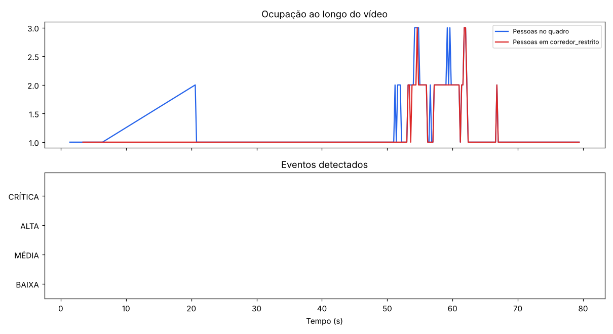

# Relatório automático de vídeo – corredor_vtest.avi

- Paciente: **CORREDOR** | Modo: **monitoramento**
- Duração: 79.5 s | FPS: 10 | Frames analisados: 398
- Pessoas rastreadas: 13
- Objetos detectados (YOLOv8): person (2305), truck (399), car (383), bird (100), kite (8), skis (3), frisbee (2)

## Desvios e eventos detectados

Nenhum desvio em relação ao padrão esperado.

