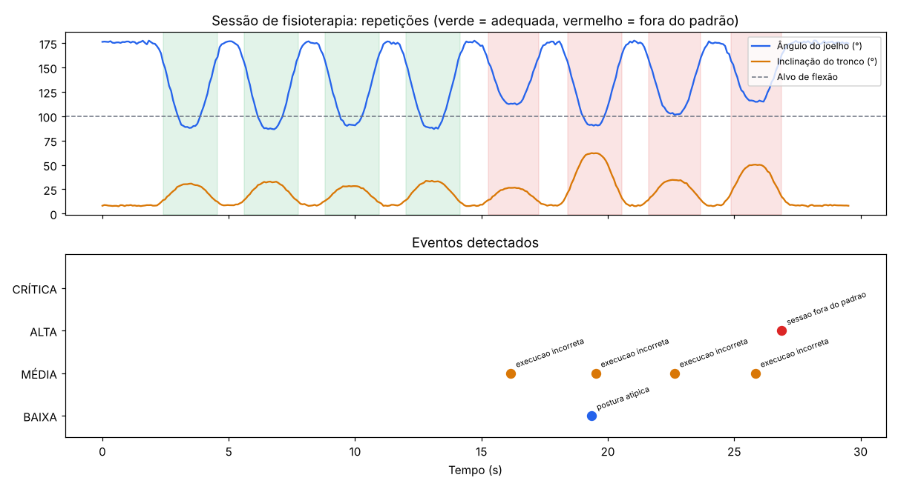

# Relatório automático de vídeo – fisioterapia_simulada.mp4

- Paciente: **P001** | Modo: **fisioterapia**
- Duração: 29.6 s | FPS: 25 | Frames analisados: 370
- Pessoas rastreadas: 1
- Objetos detectados (YOLOv8): nenhum

## Desvios e eventos detectados

| Tempo | Severidade | Tipo | Descrição |
|---|---|---|---|
| 16.2 s (10:00:16) | MEDIA | execucao_incorreta | Repetição 5 de agachamento: amplitude insuficiente (joelho mínimo 113° > alvo 100°). |
| 19.4 s (10:00:19) | BAIXA | postura_atipica | Padrão postural atípico por 0.6 s (Isolation Forest sobre ângulos articulares). |
| 19.5 s (10:00:19) | MEDIA | execucao_incorreta | Repetição 6 de agachamento: inclinação excessiva do tronco (62°). |
| 22.6 s (10:00:22) | MEDIA | execucao_incorreta | Repetição 7 de agachamento: amplitude insuficiente (joelho mínimo 102° > alvo 100°); assimetria entre joelhos (34°). |
| 25.8 s (10:00:25) | MEDIA | execucao_incorreta | Repetição 8 de agachamento: amplitude insuficiente (joelho mínimo 115° > alvo 100°); inclinação excessiva do tronco (50°). |
| 26.9 s (10:00:26) | ALTA | sessao_fora_do_padrao | 4 de 8 repetições fora do padrão esperado. Sugere fadiga, dor ou necessidade de ajustar o exercício. |

## Repetições do exercício

| # | Início (s) | Joelho mín. (°) | Tronco máx. (°) | Assimetria (°) | Problemas |
|---|---|---|---|---|---|
| 1 | 2.4 | 88 | 31 | 5 | adequada |
| 2 | 5.6 | 87 | 33 | 5 | adequada |
| 3 | 8.8 | 91 | 28 | 6 | adequada |
| 4 | 12.0 | 87 | 34 | 5 | adequada |
| 5 | 15.3 | 113 | 27 | 7 | amplitude insuficiente (joelho mínimo 113° > alvo 100°) |
| 6 | 18.4 | 90 | 62 | 5 | inclinação excessiva do tronco (62°) |
| 7 | 21.6 | 102 | 35 | 34 | amplitude insuficiente (joelho mínimo 102° > alvo 100°); assimetria entre joelhos (34°) |
| 8 | 24.9 | 115 | 50 | 5 | amplitude insuficiente (joelho mínimo 115° > alvo 100°); inclinação excessiva do tronco (50°) |

