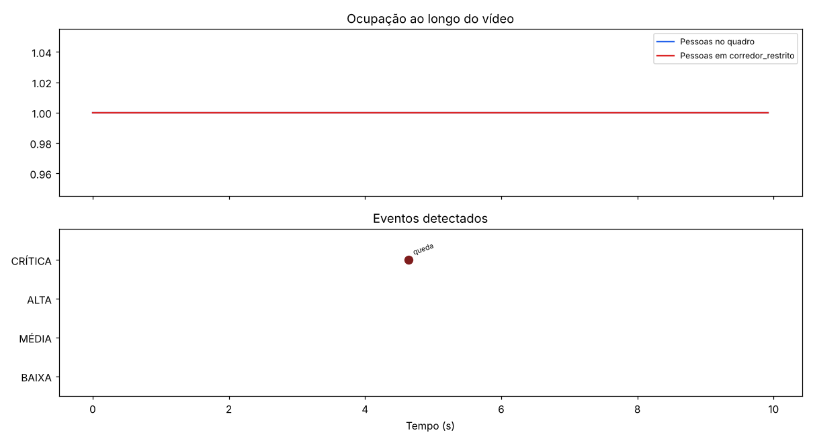

# Relatório automático de vídeo – queda_simulada.mp4

- Paciente: **P004** | Modo: **monitoramento**
- Duração: 10.0 s | FPS: 25 | Frames analisados: 125
- Pessoas rastreadas: 1
- Objetos detectados (YOLOv8): person (125), tennis racket (2)

## Desvios e eventos detectados

| Tempo | Severidade | Tipo | Descrição |
|---|---|---|---|
| 4.6 s (11:29:59) | CRITICA | queda | Possível queda da pessoa #1: quadril desceu 34% da altura corporal em <1 s e terminou em posição horizontal. |

